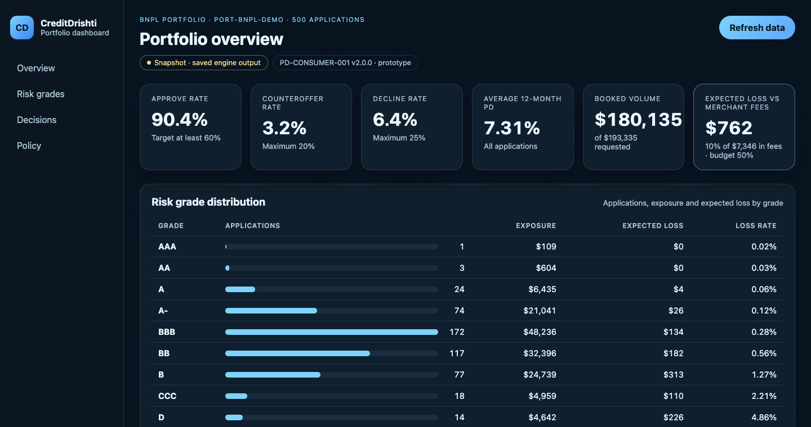

# CreditDrishti

**Credit decisioning and risk infrastructure for US BNPL and embedded-finance lenders.**
Every credit decision comes back with the expected loss in dollars and the reasons attached.

**Live site:** [creditdrishti.com](https://creditdrishti.com) ·
[Sample decision package (PDF)](https://creditdrishti.com/sample-decision-package.pdf)



<sub>Portfolio dashboard scoring 500 synthetic applications (not real borrowers) with the prototype scorecard.</sub>

## What this repository is

The source of the public marketing website, served by GitHub Pages. It's plain HTML, CSS and
JavaScript, with no build step and no framework.

The product itself (scoring engine, policy engine, API and dashboard) is developed in a separate
private repository. Nothing in this repository is product code.

## What the site covers

| Section | What a visitor gets |
|---|---|
| Hero | The promise in one line, with approve and decline examples from the scoring engine |
| How it works | Application data in, decision package out: flow, API request and response |
| Product | A full sample decision package, a downloadable PDF and a dashboard screenshot |
| Expected loss | Plain-English PD, LGD, EAD and ECL, plus a calculator comparing loss with order revenue |
| Why CreditDrishti | Comparison with bureau scores, rules engines and building in-house |
| Buyer's checklist | Straight answers on integration, latency, policy control, audit records and model quality |
| Security & data | What a backtest needs, where it runs, and where the company is today |
| Backtest request | A form for lenders who want to run their own order history |

## Where things stand

CreditDrishti is an early-stage prototype. The site says so plainly:

- Example numbers come from the real scoring engine run on **synthetic** applicants.
- The scorecard uses expert-set assumptions and is **not yet calibrated** to lender data.
- There is no SOC 2 report yet, and no pre-built integrations.

Please keep it that way. Every claim on the site should be something the product does today.

## Repository layout

| Path | Purpose |
|---|---|
| `index.html` | Home page |
| `privacy.html`, `terms.html` | Privacy policy and terms of use |
| `styles.css` | Styles for all pages |
| `app.js` | Example tabs, expected-loss calculator, form handler |
| `sample-decision-package.pdf` | Downloadable sample (generated, see below) |
| `og-image.png` | 1200×630 link-preview image (generated, see below) |
| `dashboard-screenshot.png` | Screenshot of the product dashboard |
| `assets-src/` | Sources and build script for the generated files |
| `robots.txt`, `sitemap.xml` | Search-engine files |
| `CNAME`, `.nojekyll` | Custom domain and GitHub Pages settings |

## Working on the site

**Preview locally:**

```bash
python3 -m http.server 8000
# open http://localhost:8000
```

**Publish:** commit and push to `main`. GitHub Pages redeploys in about a minute.

**Rebuild the PDF and preview image** after editing anything in `assets-src/`:

```bash
bash assets-src/build.sh
```

### Keep the numbers consistent

The same example appears in several places. If the scoring engine changes, update all of them
together from fresh engine output:

| Example | Numbers |
|---|---|
| Approve (BNPL-APP-0042) | PD 3.49% × LGD 65% × $1,200 = **$27.23** expected loss, grade BBB |
| Decline (BNPL-APP-0117) | PD 43.6% × LGD 65% × $900 = **$255.05** expected loss, grade D |

They appear in the hero tabs, the sample decision package, the API example (`index.html`), the
calculator defaults (`index.html`, `app.js`), `assets-src/sample-report.html` and
`assets-src/og-card.html`. Grades use the product's AAA–D scale.

## Contact form

The backtest request form posts to [Formspree](https://formspree.io), which emails each
submission. The form's endpoint is the `action` attribute in `index.html`. Restrict the form to
`creditdrishti.com` in Formspree's settings so it can't be used from other sites.

## Hosting and domain

- **Hosting:** GitHub Pages from `main`, folder `/` (root).
- **Domain:** `creditdrishti.com`, set in `CNAME`. DNS is at GoDaddy: four A records to GitHub
  Pages and a `www` CNAME to `purirajan.github.io`. HTTPS is enforced.
- **Live features:** GitHub Pages serves static files only. Anything that needs a server, such
  as a live scoring demo, must be hosted separately and called from `app.js`. Never put API keys
  or secrets in this repository; everything here is public.

## License

© 2026 CreditDrishti. All rights reserved. The content and design of this site may not be
reused without permission. See the [terms of use](https://creditdrishti.com/terms.html).
